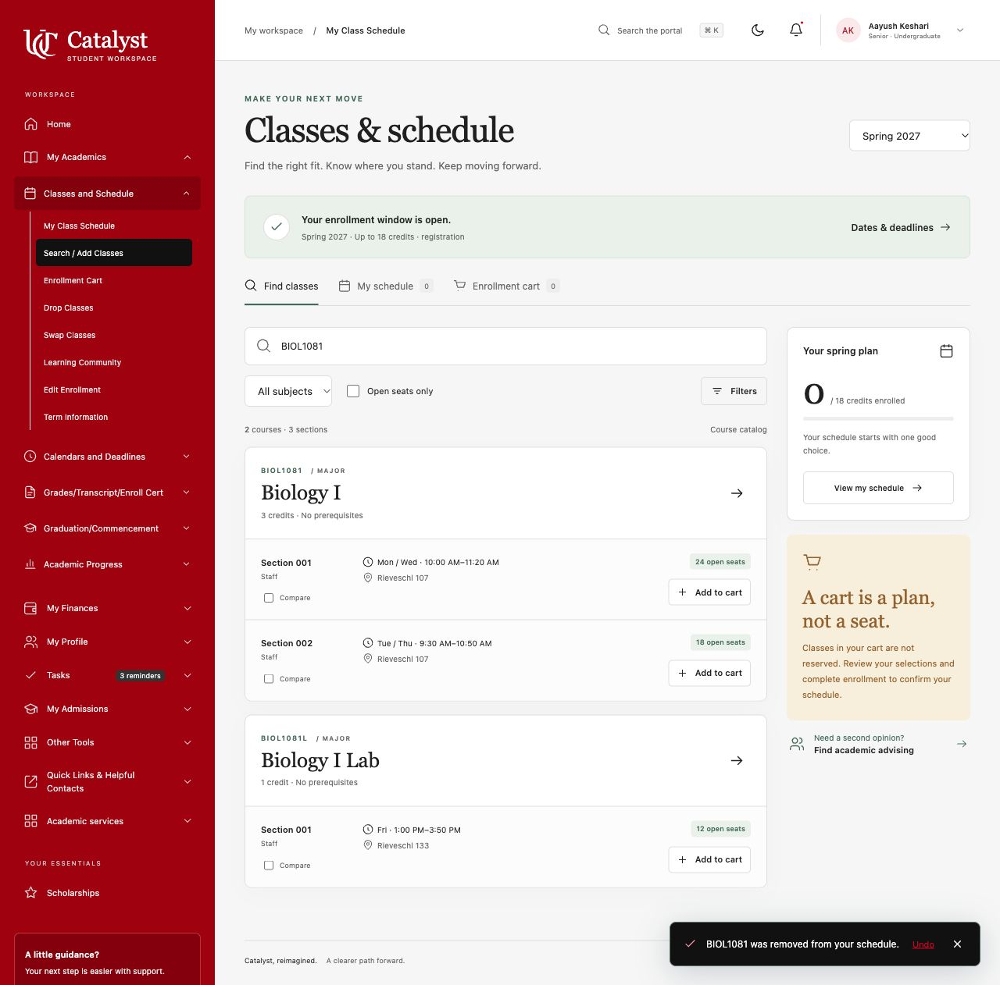

# Catalyst, reimagined

We built this redesign of UC’s Catalyst portal for our User Interface course. The main thing we wanted to improve was registration: finding a class, comparing sections, and checking how it fits into a schedule should feel like one process.

**Aayush Keshari · Nipun Chandra · Shivam Kharangate**

[Open Catalyst](https://aayushkeshari.github.io/catalyst-reimagined/) · [Case study](https://aayushkeshari.github.io/catalyst-reimagined/#/case-study) · [Figma](https://www.figma.com/design/QmzVctFez8wJ2DL9re1hA9/Untitled?node-id=0-1) · [Video walkthrough](https://youtu.be/yZYuDvyQYdc)



## About the project

Class search, the enrollment cart, and the schedule share the same data. You can compare sections, add them to your cart, and review them before enrolling. If two classes overlap or a prerequisite is missing, the cart explains what needs to change. Dropping a class also gives you an undo option.

For a quick example, search for **CS5167** in Spring 2027. Its sections meet at different times, so you can compare them against the classes already in your schedule. The catalog has 50 courses and 74 sections, including the courses used in the academic requirements page.

We also kept Catalyst’s broader navigation: academics, finances, profile, tasks, admissions, tools, and campus contacts. Academic requirements, grades, and course history use a shared set of records. Current and planned courses stay separate from earned credits.

This is a standalone front end built with **Svelte 5 and Vite**. Changes are saved in your browser; they aren’t submitted to UC.

## Run locally

Use Node.js 22.12 or newer.

```sh
npm ci
npm run dev
```

Open the address printed in the terminal. To check the code and build the site:

```sh
npm run check
npm test
npm run build
```

The build goes into `dist/`. Run `npm run preview` to serve it locally, or open `dist/standalone.html` directly. GitHub Pages deploys from `main` after the checks, tests, and build pass.

## Finding your way around the code

Pages are in `src/pages/`, and shared components are in `src/lib/components/`. Course sections live in `src/lib/catalog.js`; academic records are in `src/lib/data/`. Enrollment checks, saved state, and calendar export are handled by `src/lib/model.js` and `src/lib/store.js`.

The [case study](https://aayushkeshari.github.io/catalyst-reimagined/#/case-study) covers the research, design decisions, and screenshots.

The project started in [UI-catalyst](https://github.com/nightfury3128/UI-catalyst). This repository contains the current implementation.
